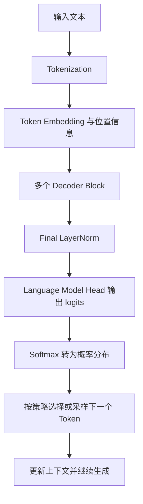

---
tags:
  - 主题/Transformer
  - 类型/每日笔记
aliases:
  - "Day43"
---

# Day43 - Transformer 架构入门

**学习阶段：** Week7  
**学习主题：** Transformer Architecture  
**学习日期：** 2026-11-14  
**学习状态：** 理论学习完成，代码待验收

## 1. Transformer 是什么？

Transformer 是一种基于 Attention（注意力机制）的深度学习架构，由 2017 年论文《Attention Is All You Need》提出。

核心特点：

- 利用 Attention 建模不同 Token 之间的关系。
- 训练时可以并行计算一段已知序列各位置的表示；因果模型仍需通过掩码阻止未来信息泄漏。
- 是现代大语言模型的重要基础。

**并行训练不等于并行生成：** GPT 自回归生成时，后一个 Token 依赖已有 Token，通常逐个生成；处理已有提示词的阶段可以并行计算多个位置。

## 2. Encoder 和 Decoder

| 架构 | 代表模型 | 主要用途 |
|---|---|---|
| Encoder-only | BERT | 文本理解 |
| Decoder-only | GPT | 文本生成 |
| Encoder-Decoder | T5 | 文本转换任务 |

GPT 使用 Decoder-only 架构，核心任务是根据已有 Token 预测下一个 Token。这个过程叫作自回归生成（Autoregressive Generation）。

原始 Transformer 的 Decoder 还包含与 Encoder 输出交互的交叉注意力；GPT 的 Decoder-only 结构不包含这部分。

## 3. Causal Mask（因果掩码）

作用：防止当前位置的表示使用未来 Token 的信息。下表中，行是查询位置，列是被关注的位置；当前位置的输出用于预测下一个 Token，因此可以关注自身及之前的位置。

| Token | 我 | 喜欢 | 学习 | AI |
|---|---|---|---|---|
| 我 | 1 | 0 | 0 | 0 |
| 喜欢 | 1 | 1 | 0 | 0 |
| 学习 | 1 | 1 | 1 | 0 |
| AI | 1 | 1 | 1 | 1 |

这里的 1 表示逻辑上允许关注，0 表示不允许。**这不是可以直接通用于所有 API 的布尔掩码。**

- `nn.MultiheadAttention` 的布尔 `attn_mask`：`True` 表示屏蔽，`False` 表示允许。
- `torch.nn.functional.scaled_dot_product_attention` 的布尔 `attn_mask`：`True` 表示允许，`False` 表示屏蔽。

所以同一张逻辑表在这两个 API 中需要不同的布尔表示。下方代码使用 `nn.MultiheadAttention`，用上三角的 `True` 屏蔽未来位置。[PyTorch 掩码说明](https://docs.pytorch.org/docs/stable/generated/torch.nn.MultiheadAttention.html)

## 4. Q、K、V 注意力机制

| 符号 | 英文 | 作用 |
|---|---|---|
| Q | Query | 查询信息 |
| K | Key | 匹配相关性 |
| V | Value | 提供实际信息 |

缩放点积注意力：

$$
\operatorname{Attention}(Q,K,V)
=\operatorname{softmax}\left(\frac{QK^{\mathsf T}}{\sqrt{d_k}}+M\right)V
$$

其中，$d_k$ 是每个 Head 中 Query/Key 的特征维度，Softmax 沿 Key 位置计算。$M$ 是可选的加性掩码：允许位置为 $0$，屏蔽位置为 $-\infty$；不需要掩码时省略 $M$。

计算流程：

1. Q 与 K 计算相关程度，并除以 $\sqrt{d_k}$ 缩放。
2. 如有掩码，先屏蔽不允许关注的位置。
3. Softmax 转换为注意力权重。
4. 权重与 V 相乘，得到 Attention 输出。

记忆：Q 和 K 决定关注谁，V 决定获取什么信息。[原论文 §3.2.1](https://arxiv.org/html/1706.03762v7)

## 5. Multi-Head Attention

多头注意力让模型通过多组投影学习 Token 之间的关系。

主要过程：

1. 将输入分别投影为多组 Q、K、V。
2. 多个 Attention Head 并行计算。
3. 拼接各个 Head 的输出。
4. 经过线性变换得到最终结果。

在本次 `embed_dim=8`、`num_heads=2` 的练习中，每个 Head 的特征维度为 $8/2=4$。

### 最小因果注意力示例（独立 CPU 检查已通过）

下面是独立的 CPU 示例，用于检查掩码与形状；它不是完整 GPT 模型。

```python
import torch
from torch import nn

torch.manual_seed(0)
x = torch.randn(1, 4, 8, device="cpu")
attention = nn.MultiheadAttention(
    embed_dim=8, num_heads=2, dropout=0.0,
    batch_first=True, device="cpu",
)
attention.eval()

# 行是 Query，列是 Key；True 屏蔽未来位置。
causal_mask = torch.triu(
    torch.ones(4, 4, dtype=torch.bool, device="cpu"), diagonal=1
)
with torch.no_grad():
    output, weights = attention(
        x, x, x, attn_mask=causal_mask,
        need_weights=True, average_attn_weights=False,
    )

print(output.shape)   # 预期：torch.Size([1, 4, 8])
print(weights.shape)  # 预期：torch.Size([1, 2, 4, 4])
```

权重保留 Head 维度，因此形状为 `(batch, heads, query长度, key长度)`。整理时在 PyTorch 2.8.0 CPU 环境检查了上述形状、被屏蔽位置的权重为 0，以及改变最后一个输入 Token 不会改变之前位置的输出。这个检查只针对补充片段。

## 6. Feed Forward Network（FFN）

前馈神经网络进一步加工每个 Token 的特征。同一个 FFN 独立应用于各位置，位置之间的信息交互主要由 Attention 完成。

本次练习结构：

`Input → Linear → GELU → Linear → Output`

例如：`8 → 16 → GELU → 8`。这是缩小后的练习规模，不是所有 Transformer 的固定维度。

原始论文 §3.3 使用 ReLU；本次代码采用 GELU，是另一种 FFN 激活函数选择。[原论文 §3.3](https://arxiv.org/html/1706.03762v7)

## 7. Residual Connection（残差连接）

残差连接公式：

$$
y=F(x)+x
$$

作用：

- 保留原始输入信息。
- 帮助梯度传播。
- 使深层神经网络更容易训练。

相加时两条分支的形状需要匹配。

## 8. Layer Normalization（层归一化）

作用：对每个 Token 的特征进行归一化，再进行可学习的仿射变换，帮助稳定模型训练。

完整公式：

$$
y_i=\gamma_i\frac{x_i-\mu}{\sqrt{\sigma^2+\varepsilon}}+\beta_i
$$

$\mu$ 和 $\sigma^2$ 是归一化维度上的均值和方差；$\varepsilon$ 用于数值稳定，$\gamma_i$ 与 $\beta_i$ 是可学习的缩放与偏移参数。

PyTorch 实现（假设已导入 `torch` 和 `torch.nn as nn`）：

```python
layer_norm = nn.LayerNorm(8)
norm_input = torch.randn(1, 4, 8)
output = layer_norm(norm_input)
```

`nn.LayerNorm(8)` 对最后一维的 8 个特征归一化，各 Token 分别计算统计量。默认 `elementwise_affine=True`，学习缩放与偏移；因此训练后的最终输出不保证均值为 0、方差为 1。[PyTorch LayerNorm](https://docs.pytorch.org/docs/stable/generated/torch.nn.LayerNorm.html)

## 9. Transformer Block 完整结构

以 GPT-2 风格的 Pre-LN Decoder Block 为例，省略 Dropout：

$$
x'=x+\operatorname{MaskedAttention}(\operatorname{LN}(x))
$$

$$
y=x'+\operatorname{FFN}(\operatorname{LN}(x'))
$$

主要组件：

- LayerNorm。
- Masked Multi-Head Self-Attention。
- Residual Connection。
- Feed Forward Network。

**Pre-LN 与 Post-LN 的位置不同：** 上面先归一化，再进入子层；原始 Transformer 采用 Post-LN，即 $\operatorname{LN}(x+F(x))$。不能把这两种顺序混为一谈。[原论文 §3.1](https://arxiv.org/html/1706.03762v7)；[GPT-2 报告 §2.3](https://cdn.openai.com/better-language-models/language_models_are_unsupervised_multitask_learners.pdf)

多个 Block 堆叠后形成模型主体；还需要 Embedding、位置信息和输出层等部分，才能组成完整语言模型。

## 10. GPT 整体处理流程

以 GPT-2 风格的模型为例：



Language Model Head 输出的是分数，不是已经选好的 Token。自回归生成通常读取最后一个位置的分数；训练时可以同时计算多个位置的下一 Token 预测。

### 本日代码范围

现有 `code/day43_Transformer architecture introduction/main.py` 演示了注意力、多头注意力、FFN、残差和 LayerNorm 等组件。手写 QKV 示例没有除以 $\sqrt{d_k}$，属于未缩放的点积注意力；`nn.MultiheadAttention` 调用没有传入因果掩码，可以关注全部输入位置。这些是组件演示，尚不能作为完整的因果 GPT 实现。

上面的 CPU 片段补充并检查了因果掩码；原有组件脚本与完整 Block 的验收仍待完成，**本日学习状态继续保留“理论学习完成，代码待验收”**。

## 11. 本日核心知识检查

- 理解 Transformer 基本概念。
- 理解 Encoder 和 Decoder。
- 理解 Causal Mask，以及不同 API 的布尔掩码约定。
- 理解 Q、K、V 与缩放点积注意力。
- 理解 Multi-Head Attention。
- 理解 FFN。
- 理解 Residual Connection。
- 理解 Layer Normalization。
- 理解 Transformer Block，并区分 Pre-LN 与 Post-LN。

以上作为自查清单，原有组件脚本与完整 Block 仍按“待验收”处理。

## 12. 下一步学习

Day44：Tokenization（分词技术）

学习内容：

1. Token 的概念。
2. Token、字符和单词的区别。
3. BPE 分词算法。
4. Hugging Face Tokenizer 实践。

**本日总结：**

Transformer 是现代 LLM 的核心架构基础。理解了 Attention、FFN、残差连接和归一化之后，就能够进一步理解 GPT 等大语言模型的内部工作方式。

## 知识关联

- 主题入口：[[maps/Transformer与LLM基础|Transformer与LLM基础]]
- 前置知识：[[notes/Day39：PyTorch 神经网络基础|Day39：nn.Module、Linear 与激活函数]]
- 框架基础：[[maps/PyTorch与深度学习|PyTorch与深度学习]]

## 参考资料

- [Attention Is All You Need](https://arxiv.org/html/1706.03762v7)：§3.1、§3.2、§3.3 与 §3.4，架构、Attention、FFN 和输出概率。
- [GPT-2 技术报告](https://cdn.openai.com/better-language-models/language_models_are_unsupervised_multitask_learners.pdf)：§2.3，归一化移至子层输入及最终 LayerNorm。
- [PyTorch MultiheadAttention](https://docs.pytorch.org/docs/stable/generated/torch.nn.MultiheadAttention.html) 与 [scaled_dot_product_attention](https://docs.pytorch.org/docs/stable/generated/torch.nn.functional.scaled_dot_product_attention.html)：布尔掩码约定不同。
- [PyTorch LayerNorm](https://docs.pytorch.org/docs/stable/generated/torch.nn.LayerNorm.html)：归一化维度与可学习仿射参数。
